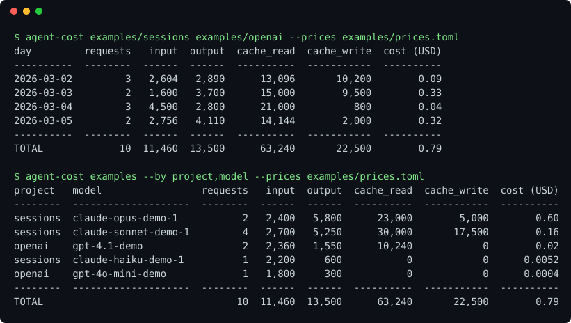

# agent-cost

[](https://github.com/YusufBeratZengin/agent-cost/actions/workflows/ci.yml) [](https://pypi.org/project/agent-cost/) [](LICENSE) [](pyproject.toml) 

English | [Türkçe](README.tr.md)

Turn the local session logs of your AI coding agents into a token and estimated cost report, by day, session, project or model.

It reads files you already have on disk, makes no network requests and has no dependencies, so your logs never leave your machine.

```bash
pip install agent-cost
agent-cost examples/sessions examples/openai --prices examples/prices.toml
```

> Not on PyPI yet? Use `pip install .` from a clone. The `pip install agent-cost` line works after the first release.



## Demo

Real output on the synthetic logs in [`examples/`](examples):

```text
$ agent-cost examples/sessions examples/openai --prices examples/prices.toml
day         requests   input  output  cache_read  cache_write  cost (USD)
----------  --------  ------  ------  ----------  -----------  ----------
2026-03-02         3   2,604   2,890      13,096       10,200        0.09
2026-03-03         2   1,600   3,700      15,000        9,500        0.33
2026-03-04         3   4,500   2,800      21,000          800        0.04
2026-03-05         2   2,756   4,110      14,144        2,000        0.32
----------  --------  ------  ------  ----------  -----------  ----------
TOTAL             10  11,460  13,500      63,240       22,500        0.79
```

Group by several dimensions and filter by date:

```text
$ agent-cost examples/sessions --by project,model --since 2026-03-03 --prices examples/prices.toml
project     model                 requests  input  output  cache_read  cache_write  cost (USD)
----------  --------------------  --------  -----  ------  ----------  -----------  ----------
-demo-blog  claude-opus-demo-1           1  1,500   3,200       8,000        2,000        0.31
-demo-shop  claude-opus-demo-1           1    900   2,600      15,000        3,000        0.29
-demo-blog  claude-sonnet-demo-1         1    700   1,100           0        6,500        0.04
-demo-shop  claude-sonnet-demo-1         1    500   1,900      21,000          800        0.04
-demo-shop  claude-haiku-demo-1          1  2,200     600           0            0      0.0052
----------  --------------------  --------  -----  ------  ----------  -----------  ----------
TOTAL                                    5  5,800   9,400      44,000       12,300        0.69
```

## Important: verify the prices yourself

The cost column is an **estimate**. The built-in price table contains **example values only**: they may be wrong or outdated, and your plan, region or contract may differ. Always pass your own table with `--prices`. When the built-in table is used, the CLI says so on stderr. Subscription plans (flat monthly fee) have no per-token cost at all; read the numbers as "what this usage would cost at API prices".

## Install

```bash
pip install agent-cost        # after the first release
pip install .                 # from a clone
```

Python 3.10 or newer. No runtime dependencies.

## Usage

```bash
agent-cost PATH [PATH ...] [options]
```

`PATH` is a log file or a folder (searched recursively for `*.jsonl` and `*.ndjson`).

| Option | Meaning |
|---|---|
| `-r, --reader` | `auto` (default, tries every reader per line), `claude-code`, `openai` |
| `-b, --by` | Comma-separated grouping: `day`, `session`, `project`, `model`. Default `day` |
| `-p, --prices FILE` | Price table (TOML or JSON). See below |
| `-f, --format` | `table` (default), `csv`, `json` |
| `--since`, `--until` | `YYYY-MM-DD`, UTC, both inclusive. Records without a timestamp are dropped when a date filter is set |
| `--project`, `--model` | Keep rows whose project or model name contains the text (case-insensitive) |
| `--print-default-prices` | Print the built-in example table as TOML (a starting point for your own) |

Exit codes: `0` success, `2` bad input (bad date, missing path, invalid price file).

### Price table

Prices are per **1,000,000 tokens**. Model names match exactly, otherwise by the longest key that is a prefix of the model name, otherwise the longest key contained in it. So `claude-sonnet` covers every `claude-sonnet-*` id. Models without a match are counted but marked `*` and left out of the cost.

```toml
currency = "USD"

[models."claude-sonnet"]
input = 3.0
output = 15.0
cache_read = 0.3
cache_write = 3.75
```

The same structure works as JSON: `{"models": {"claude-sonnet": {"input": 3.0, "output": 15.0}}}`. Missing keys count as `0`.

### Supported log formats

- **claude-code**: Claude Code project sessions (`projects/<folder>/<session>.jsonl`). Reads `message.usage` (`input_tokens`, `output_tokens`, `cache_read_input_tokens`, `cache_creation_input_tokens`). The project is the first folder under the path you scan. Streamed messages that were logged more than once (same message and request id) are counted once.
- **openai**: any JSONL line with a `usage` object, optionally wrapped in `response` or `body`. Understands `prompt_tokens` / `completion_tokens` and `input_tokens` / `output_tokens`. Cached tokens (`cached_tokens`) are reported by OpenAI as part of the prompt, so they are moved from input to cache read.

Adding another format means writing a small reader class; see [CONTRIBUTING.md](CONTRIBUTING.md).

### Library

```python
from pathlib import Path
from agent_cost import build_report, load_prices, read_records

records = read_records([Path("examples/sessions")])
rows, total = build_report(records, load_prices(Path("examples/prices.toml")), ["model"])
print(total.total_tokens, round(total.cost, 4))
```

## Examples

[`examples/`](examples) holds fully synthetic logs (fake projects, fake content) and an example price table. Every command in this README runs against them.

## How it works

1. Walk the paths, decode each JSONL line (bad lines are skipped).
2. Each reader turns a line into a `Record` (time, session, project, model, four token counts) or ignores it.
3. Records are filtered, priced and grouped. Dates are UTC days.

## Limitations and privacy

- Costs are estimates; see the warning above. Tokens reported by the log are trusted as-is.
- Thinking or tool tokens are only counted if the agent folds them into the logged usage.
- Everything runs locally. Logs can contain private prompts and paths; agent-cost never prints message content, only counts and names of projects, sessions and models.

## Development

```bash
python -m pip install -e ".[dev]"
ruff check . && ruff format --check .
mypy
pytest
python scripts/make-demo.py   # regenerate docs/demo.svg
```

Tests use synthetic data only.

## Contributing

See [CONTRIBUTING.md](CONTRIBUTING.md). Please follow the [Code of Conduct](CODE_OF_CONDUCT.md). Report vulnerabilities as described in [SECURITY.md](SECURITY.md).

## License

[MIT](LICENSE)
